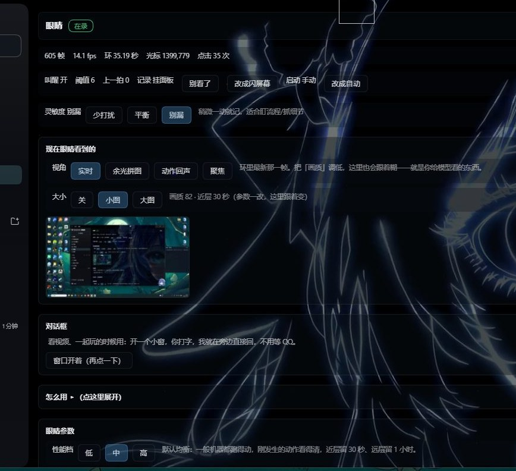
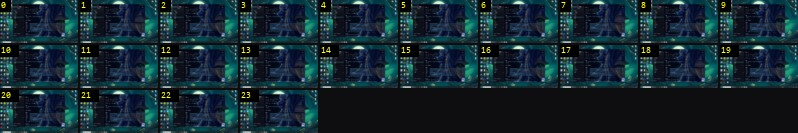

# dsh-eye —— 给 AI 装一双「看得见刚才」的眼睛

AI 平时只看得见你主动给它的那一帧截图，看不见动作发生的过程。dsh-eye 把最近的屏幕画面按帧留在内存里，让模型能回看刚才几秒～几十秒发生了什么，能按格子编号回取某一格的 1:1 原像素，能在你点完按钮后自动给出「点前 / 点后」的对比，还能在屏幕大幅变化时提醒模型（或在你眼前闪一条提示）。

屏幕帧只在内存里转：环形缓冲不写盘、不压视频、关掉就是真把采集进程杀掉。只有明确「看一眼」时，这一帧才会作为对话附件存到本机（和其他附件一样，可关、可清）。

> Windows · DSH 插件 · 自测阶段

## 它能做什么

| 能力 | 说明 |
| --- | --- |
| 回看连续画面 | 近层默认 20fps × 30 秒；远层每 2 秒一张，最多 1 小时。帧率按画面变化自适应：真静止才落到下限 5fps，慢慢动 12fps，一动就拉满 20fps（宁可多抓，不漏慢镜头） |
| 余光窗口 | 把一段时间压成一张带编号的缩略图拼图，先看哪块在动 |
| 1:1 聚焦 | 按格子编号取回原分辨率裁剪，小字能读清 |
| 看一眼（0.3.0） | 模型主动取图，三档价钱：当前一屏缩到 768 宽（约 430 token）／一块区域 1:1（约 370 token）／最近几秒抽 6 帧拼一张（约 830 token） |
| 看图预算 | 每天允许花多少视觉 token（默认 30 万），面板上能看到用了多少、一键清零；超了就停，不会偷偷花。所有会出图的工具都计入（含余光窗口/取格子/动作回声） |
| 动作回声 | 最近一次点击的「点前几帧 + 点后几帧」，用来看这一下点中没、界面有没有反应 |
| 大变化提醒 | 只在「换了前台窗口」或「整屏内容大改」时记一笔：只记面板 / 前台闪提示 / 直接叫醒模型，三选一；灵敏度分**少打扰 / 平衡 / 别漏**三档，面板一键切换 |
| 实时画面 | 面板里每 1.5 秒刷一张当前帧，能直接看见眼睛在拍什么 |
| 四种视角 | 同一块预览可切「实时 / 余光拼图 / 动作回声 / 聚焦」，就是模型实际拿到的那几张图；画质、近层时长一改，预览跟着变 |
| 性能档 | 低 / 中 / 高 一键换全套参数（内存量级约 100 / 260 / 430 MB），拖任一滑块就变「自定义」 |
| 对话框小窗 | 置顶画中画小窗，直接打字跟模型说话，不经过聊天软件 |

## 长什么样

侧栏面板：状态、灵敏度、对话框、参数、最近大变化。



把一段时间压成带编号的缩略图，先看哪一块在动，再回取那一格的 1:1 原像素：



## 性能档（低 / 中 / 高）

侧栏「眼睛参数」最上面一排，点一下就整套换掉，不用自己算六个滑块：

| 档 | 近层 | 闲着时 | 远层 | 画质 | 内存量级 | 适合 |
| --- | --- | --- | --- | --- | --- | --- |
| 低 | 15 秒 / 8fps | 3fps | 5 秒一张，留 15 分钟 | 60 | 约 100MB | 老笔记本、核显机器 |
| 中（默认） | 30 秒 / 20fps | 5fps | 2 秒一张，留 1 小时 | 82 | 约 260MB | 一般机器 |
| 高 | 45 秒 / 25fps | 6fps | 1 秒一张，留 1 小时 | 90 | 约 430MB | 好机器 |

低档是老实省：8fps 意味着 125ms 才一帧，动作过程会变粗，小字得靠「聚焦」凑近看，别指望它跟中档一样连贯。拖任一滑块，性能档会自动变成「自定义」，不假装还是预设；点回低/中/高就恢复整套。

## 组成

- `lib/` —— DSH 插件本体（Node）：起停采集进程、把能力注册成工具、侧栏面板。
- `python/` —— 采集与图像服务（Python + Pillow，可选 ffmpeg 兜底）：抓屏 → JPEG → 内存环形缓冲，本地 HTTP（127.0.0.1:13201）对外提供画面。
- `python/eye_chat.py` 对话框小窗、`python/eye_toast.py` 前台提示条、`python/eye_doctor.py` 自检。

## 安装（Windows）

前置：Python 3.10+（安装脚本会 `pip install` 抓屏依赖 `mss`）。ffmpeg 是可选的兜底：装了更稳，没有也能跑（`winget install Gyan.FFmpeg`）。分辨率、ffmpeg 路径都自动探测，不用手改。

```powershell
git clone https://github.com/chddydwd/dsh-eye.git
cd dsh-eye
powershell -ExecutionPolicy Bypass -File install.ps1
```

装完重启 DSH，左侧栏出现「眼睛」，点「打开」开始采集。脚本会把插件与采集脚本一起装进 `~\.dsh\plugins\dsh-eye`、写 `~\.dsh\eye.json`、挂进 profile 并检查 ffmpeg；不想跑脚本可以看 [INSTALL.md](INSTALL.md) 里的手动步骤。卸载用 `uninstall.ps1`。

## 工具

| 工具 | 用途 |
| --- | --- |
| `eye_status` | 眼睛现在什么样：开没开、帧数、fps、环跨多少秒、内存、提醒状态 |
| `eye_toggle` | 开 / 关（关 = 真杀进程） |
| `eye_window` | 余光窗口：一段时间压成带编号的拼图 |
| `eye_cell` | 按编号回取某一格（可指定裁剪区域）的 1:1 原像素 |
| `eye_echo` | 最近一次点击的动作回声 |
| `eye_watch` | 大变化提醒的开关、灵敏度（quiet/normal/sensitive）、阈值、间隔、去处（面板 / 闪提示 / 叫醒） |
| `eye_look` | 看一眼现在这一屏（默认缩到 768 宽，约 430 token） |
| `eye_region` | 凑近看：按屏幕坐标裁一块 1:1 原像素，或直接裁在光标处 |
| `eye_frames` | 回看刚才：从内存环抽最近 N 秒的几帧拼成一张联络表 |
| `eye_vision` | 看图总开关 + 今日预算（关掉就只读字、不出图） |
| `eye_chat` | 打开对话框小窗 / 往小窗里说话 |

面板上还能改采样参数（近层时长、帧率、闲时帧率、远层间隔与跨度、画质），改完立即生效，重启也记得。

## 环境变量（可选，一般不用动）

| 变量 | 作用 |
| --- | --- |
| `EYE_PORT` | 采集服务端口，默认 `13201` |
| `EYE_RUNTIME` | 运行参数的 JSON 路径，默认 `~\.dsh\eye-runtime.json` |
| `EYE_CAPTURE` | 设成 `ffmpeg` 就强制走 ffmpeg 抓屏（调试 / mss 出问题时用） |
| `EYE_FFMPEG` | 指定 ffmpeg 可执行文件路径 |
| `EYE_FAR_MB` | 远层（每 2 秒一张那层）内存上限，默认 `320`（MB）；内存紧就调小，能回看的时间会变短 |

## 开销（本机实测，1920×1080）

- 闲着：约 0.24 核 CPU、130MB 内存（下限 5fps 兜底，宁可多抓不漏慢镜头；动态壁纸会被判成「在动」，会更高一点）。
- 手在动：约 0.5–0.7 核、130MB。
- 默认参数下内存上限约 320MB 远层 + 近层（实测闲置约 120MB、手在动约 150–200MB，会随内存环填满略涨）；磁盘占用 0（全在内存）。
- 一张 798×450 的拼图约 222 token，与里面装多少格无关。
- 看一眼现在是 768 宽左右 430 token、一块区域 1:1 约 370 token、6 格回看表约 830 token——都比「截图给模型」便宜，比「读字」贵。小字优先用 `eye_text`（读无障碍树，几乎不花视觉 token）。

## 隐私

- 画面只在内存里，不写磁盘、不联网（只监听 127.0.0.1）。
- 关掉 = 采集进程被杀；没人动超过 10 分钟也会自动停采集，一动就回来。
- 对话框与提醒条都是本机进程，不经任何服务器。
- 看图要送模型，所以单给了闸：面板「视觉」能一键关掉（关掉就只读字、不出任何图），并设了每日 token 预算（默认 30 万），超了不再取图。

## 已知限制

- Windows，只抓主屏（按主屏实际分辨率，DPI 缩放已处理）；多屏未支持。
- 抓屏走系统级截屏（优先 mss，缺依赖时退回 ffmpeg gdigrab），被其他窗口挡住的区域看不到（抓的是屏幕像素，不是后台渲染）。
- 「大变化」是启发式判断：换前台窗口算硬事件；视频在放、页面滚动这类持续变化不算。仍可能误报或漏报，阈值可调。
- 灵敏度三档只是放宽/收紧判据（`quiet` ×1.6、`normal` ×1.0、`sensitive` ×0.6），不是保证：`sensitive` 会更灵但也更容易吵，`quiet` 更安静但会漏掉同窗口内的局部大改。

## 许可

MIT
